# Please Don't Come Here (PDCM)

**PDCM** is a tourist crowd and approach-road traffic advisory app for India. Travelers check a destination before they go: current crowd status, community traffic reports, optional external road samples, forecast honesty, and quieter nearby alternatives.

The product rule is intentional and strict:

- **UNKNOWN ≠ QUIET** — missing reports never mean a place is empty.
- **Insufficient history ≠ fabricated forecasts** — without enough same-weekday verified reports, PDCM returns insufficient data instead of inventing a score.

Built as a portfolio modular monolith (Spring Boot API + React SPA + PostgreSQL).

---

## Key features

Implemented today (not a roadmap dump):

| Area | What works |
|---|---|
| Map discover | Leaflet map + list over OSM tiles; viewport query via `GET /api/destinations/map` |
| Search & filter | Destination list/search with region/category/tags |
| Community crowd | 6-hour aggregation from **LOCATION_VERIFIED** visit reports only |
| Community traffic | Separate on-site traveler traffic channel (not merged with road data) |
| GPS verification + trust | Optional consent-gated proximity check; ADMIN verify/reject/flag; 24h coordinate purge |
| Aggregation & confidence | Deterministic crowd/traffic scores with confidence + freshness |
| Forecasts + holidays | Calendar signals (weekend / national holiday / long weekend) and conditional numeric estimates |
| Alternatives | Nearby quieter-known destinations (never ranks UNKNOWN as confirmed quiet) |
| External road traffic | TomTom Flow **pilot** for selected slugs — one nearby approach road, not destination-wide |
| Destination suggestions | Users propose places; ADMIN approve/reject; approved rows join the catalogue with UNKNOWN crowd/traffic and **no** synthetic reports |

---

## Screenshots

### Dashboard

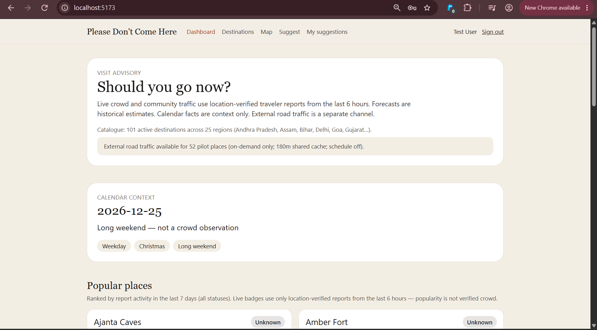

### Map discover

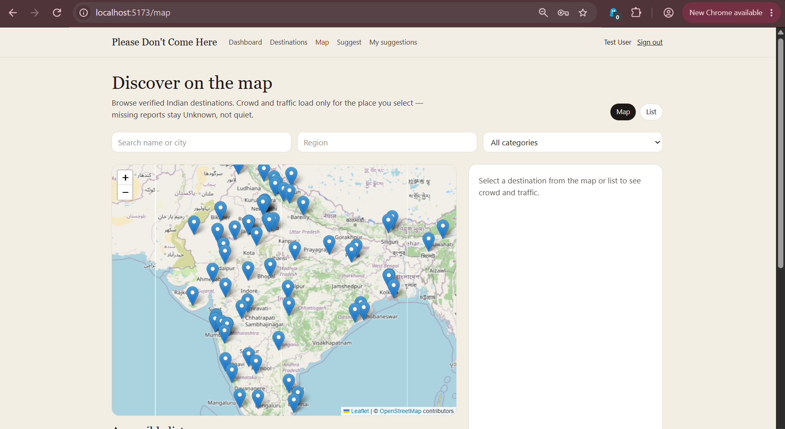

### Destination detail

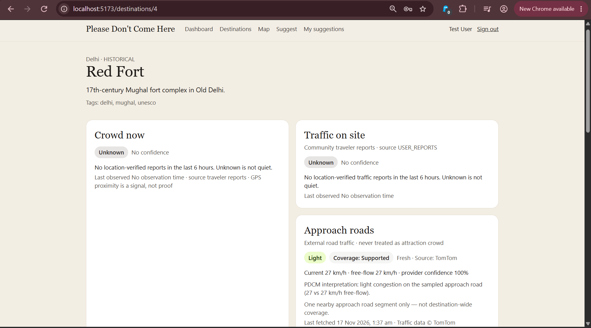

### Forecast and alternatives

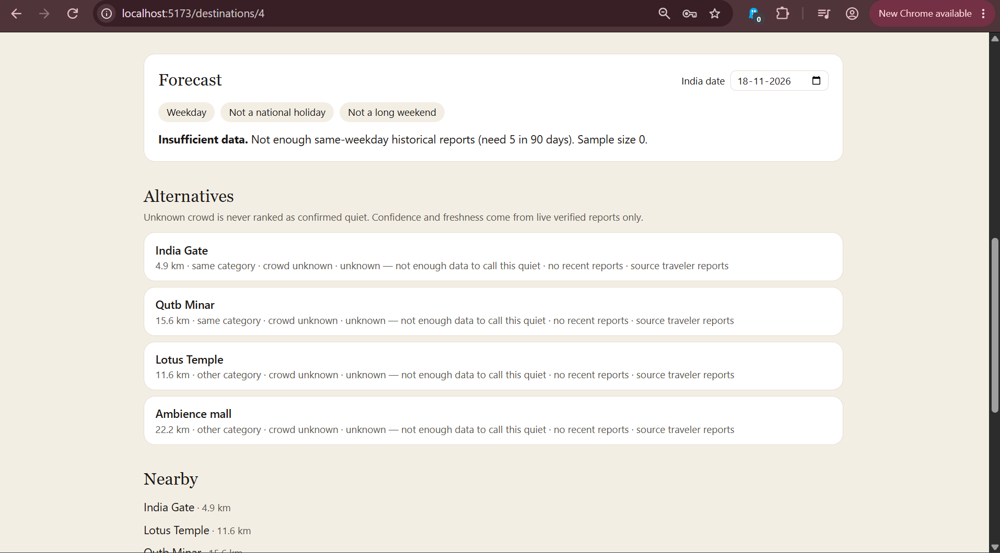

### Visit report

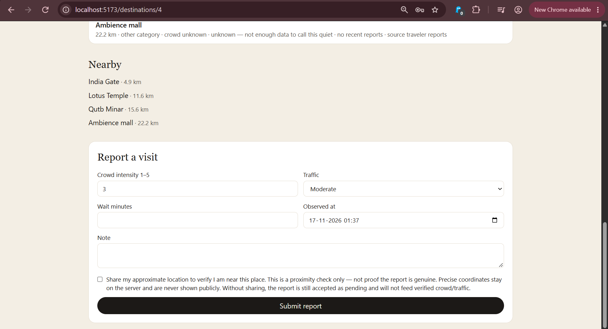

### Popular places

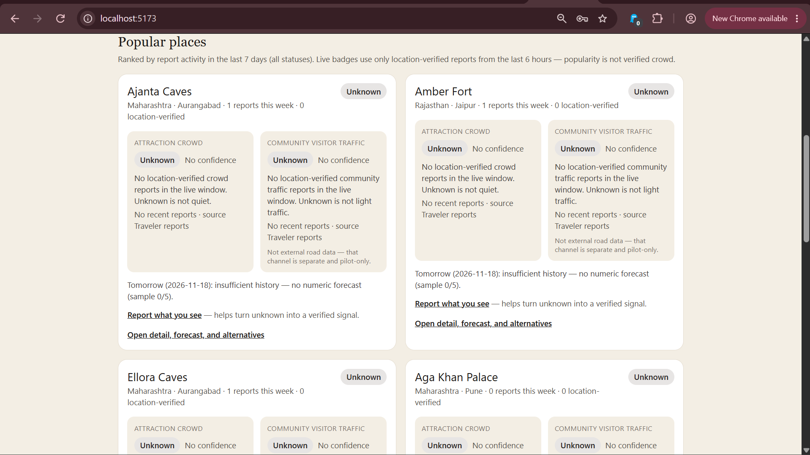

### Recent reports

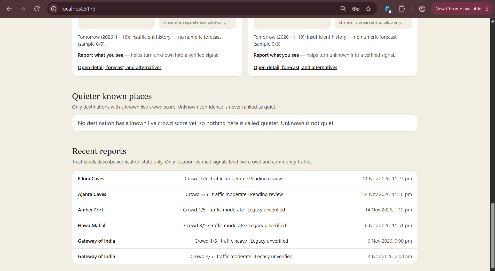

### Suggest a destination

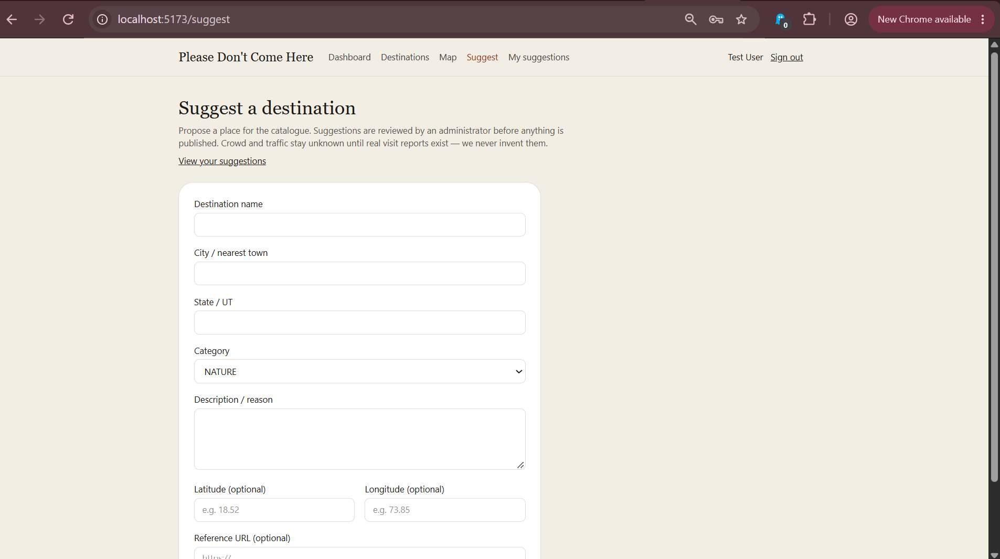

### My suggestions

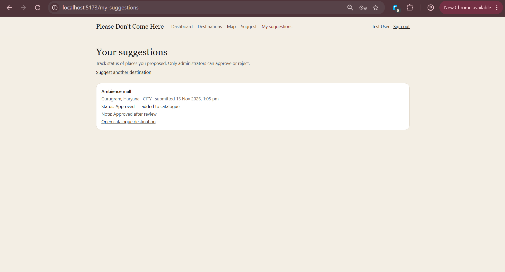

### Approved suggestion

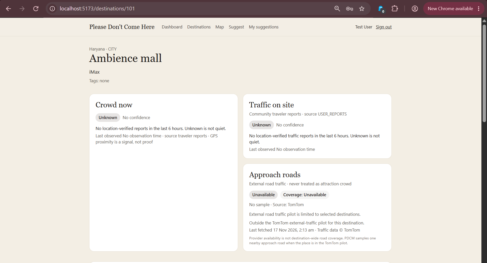

---

## How it works

PDCM keeps three signals separate on purpose:

1. **Community crowd** — how busy the attraction feels, from location-verified traveler reports.
2. **Community traffic** — on-site visitor traffic from the same report stream (still not roads).
3. **External road traffic** — TomTom Flow sample of **one nearby approach road** for pilot slugs only.

Freshness and confidence come from real observation windows. No reports → **UNKNOWN**. Provider down / non-pilot / budget exhausted → **UNAVAILABLE** (never “clear roads”). Unsuitable geometry after zoom fallback → **UNKNOWN** coverage.

**TomTom ≠ attraction crowd.** Road speed on an approach segment is never folded into crowd intensity.

Forecasts combine India calendar context with verified same-weekday history when enough samples exist; otherwise they stay insufficient. Alternatives suggest nearby places using the same honesty rules.

---

## Technology stack

Versions verified from `backend/pom.xml`, `frontend/package.json`, and `docker-compose.yml`:

| Layer | Choice | Version / notes |
|---|---|---|
| Language | Java | 25 |
| API | Spring Boot | 4.1.2 (Spring Security 7 + JWT resource server) |
| Build | Maven Wrapper | `backend/mvnw.cmd` |
| Database | PostgreSQL | 16 (Docker Compose) |
| Migrations | Flyway | enabled; JPA `ddl-auto=validate` |
| Frontend | React + TypeScript + Vite | React 19.2, Vite 7.2, TypeScript 5.9 |
| Styling | Tailwind CSS | 4.1 (Vite plugin) |
| Maps | Leaflet + react-leaflet | 1.9 / 5.0; OSM raster tiles |
| Routing | react-router-dom | 7.9 |
| Tests | JUnit 5, Mockito, Spring Boot Test, Testcontainers; Node test runner | Backend + frontend |

---

## Architecture

**Modular monolith:** one Spring Boot process, package boundaries under `com.pdcm.*`, one PostgreSQL database, separate React SPA. Crowd, community traffic, and forecasts are computed on read — no precomputed score tables.

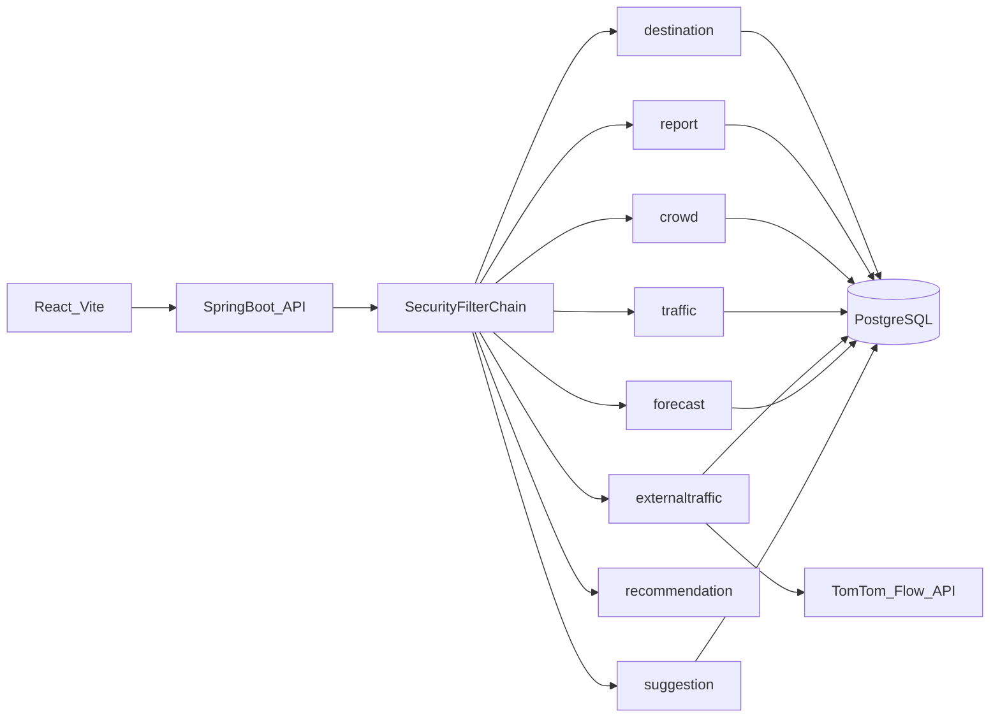

No Redis, Kafka, microservices, or PostGIS in this MVP. Details: [docs/ARCHITECTURE.md](docs/ARCHITECTURE.md).

---

## External traffic (TomTom Flow pilot)

Honest scope:

- **Slug allowlist only** — currently the original **five** configured pilots: `amber-fort`, `gateway-of-india`, `hawa-mahal`, `india-gate`, `taj-mahal`.
- **Not nationwide.** Provider `UP` does not mean every catalogue place has road coverage.
- **One nearby approach road** per pilot destination (≤750 m geometry check), never destination-wide traffic.
- **Shared in-memory cache** default **180 minutes**; single-flight per destination; zoom fallback **18 → 15 → 12 → 10** (each attempt counts).
- **Hard budgets:** 500 Flow requests/day and 15_000/month (UTC). Schedule refresh **off**. Traffic Incidents **off**. No Pay As You Grow.
- Key: `PDCM_TOMTOM_API_KEY` on the API process only — never in Vite/React or git.

### Expansion status (≥50 target)

60 existing catalogue candidates (Delhi NCR first, then famous Indian sites) are listed in [`docs/data/tomtom-pilot-candidates.csv`](docs/data/tomtom-pilot-candidates.csv). A capped validation script mirrors production zoom + geometry rules:

```powershell
# Session-only key — never commit it
$env:PDCM_TOMTOM_API_KEY = "your_free_tier_key"
powershell -File scripts\Validate-TomTomPilotCoverage.ps1
```

**Live validation in this pass:** API key was **missing** → **0** TomTom requests → **0** newly verified usable segments. Allowlist therefore stays at **5**. Results + manual plan: [docs/TOMTOM_PILOT_COVERAGE.md](docs/TOMTOM_PILOT_COVERAGE.md).

### Budget mathematics (if/when 50 pilots are verified)

| Assumption | Result |
|---|---|
| Cache 180m | ≤8 theoretical refreshes/destination/day if every TTL is used |
| 50 × 8 | 400 refreshes/day |
| 1 Flow call each | ~12_000 / month → ~3_000 headroom under the 15_000 app cap |
| Worst case 4 zooms every refresh | 1_600/day → ~48_000/month — **exceeds** free-tier and app caps |
| Daily hard budget 500 | Always wins over desired cadence |
| TomTom free ~20k/month | PDCM stays under 15k Flow; no paid billing |

There is **no** promise of 8 refreshes/day for every pilot place. On-demand + shared cache only.

Licensing notes (not a legal clearance): [docs/TOMTOM_LICENSING_NOTES.md](docs/TOMTOM_LICENSING_NOTES.md).

---

## Data provenance

- **~100** active destinations after Flyway V6.
- **20** legacy seeds (`LEGACY_SEED`) + **80** Wikidata-verified rows (CC0 coordinates).
- Live crowd/traffic still require **real** location-verified reports — catalogue expansion does not seed observations.

Full sourcing and OSM tile attribution: [docs/DATA_PROVENANCE.md](docs/DATA_PROVENANCE.md).

---

## Getting started

Requirements: **Java 25**, **Docker**, **Node.js 24+**, Maven Wrapper (included).

### 1. Database (PowerShell, repo root)

```powershell
docker compose up -d
# Postgres on localhost:5433  (db/user/password: pdcm)
```

### 2. Backend API

```powershell
cd backend
# Optional (recommended for non-local demos):
# $env:PDCM_JWT_SECRET = "<32+ char secret>"
# $env:PDCM_ADMIN_PASSWORD = "<admin password>"
# $env:PDCM_TOMTOM_API_KEY = "<free-tier key>"   # API process only
$env:JAVA_TOOL_OPTIONS = "-Duser.timezone=UTC"
.\mvnw.cmd spring-boot:run
# http://localhost:8080
```

### 3. Frontend

```powershell
cd frontend
npm install
npm run dev
# http://localhost:5173
# Map: /map · Suggest: /suggest · Admin moderation: /admin/moderation · Admin suggestions: /admin/suggestions
```

Vite proxies `/api` to the backend. Optional: `$env:VITE_OSM_TILE_URL` to override the OSM raster template (default community tiles; follow the [OSM tile usage policy](https://operations.osmfoundation.org/policies/tiles/)).

### 4. Tests

```powershell
cd backend
.\mvnw.cmd test

cd ..\frontend
npm test
```

### Environment variables (no secrets in git)

| Variable | Where | Purpose |
|---|---|---|
| `PDCM_JWT_SECRET` | API | HS256 secret (≥32 chars). Dev default exists for local only. |
| `PDCM_ADMIN_EMAIL` / `PDCM_ADMIN_PASSWORD` / `PDCM_ADMIN_DISPLAY_NAME` | API | Optional admin bootstrap |
| `PDCM_CORS_ORIGIN` | API | CORS origin (default `http://localhost:5173`) |
| `PDCM_TOMTOM_API_KEY` | API only | Enables TomTom Flow for pilot slugs |
| `VITE_OSM_TILE_URL` | Frontend | Optional OSM tile URL template |

Never commit real keys. Prefer `.env` / `application-local.yml` (gitignored) for machine-local overrides.

---

## API and project docs

| Doc | Purpose |
|---|---|
| [docs/API_DOCUMENTATION.md](docs/API_DOCUMENTATION.md) | Endpoint contracts |
| [docs/ARCHITECTURE.md](docs/ARCHITECTURE.md) | Modules and request flow |
| [docs/DATABASE_DESIGN.md](docs/DATABASE_DESIGN.md) | Schema and aggregation rules |
| [docs/PROJECT_REQUIREMENTS.md](docs/PROJECT_REQUIREMENTS.md) | Product rules (P0/P1/P2) |
| [docs/TECHNICAL_DECISIONS.md](docs/TECHNICAL_DECISIONS.md) | Decision log |
| [docs/DEVELOPMENT_ROADMAP.md](docs/DEVELOPMENT_ROADMAP.md) | Build phases |
| [docs/DATA_PROVENANCE.md](docs/DATA_PROVENANCE.md) | Catalogue sourcing |
| [docs/TOMTOM_PILOT_COVERAGE.md](docs/TOMTOM_PILOT_COVERAGE.md) | Pilot candidates + validation |
| [docs/TOMTOM_LICENSING_NOTES.md](docs/TOMTOM_LICENSING_NOTES.md) | Flow caching / terms notes |
| [docs/LEARNING_NOTES.md](docs/LEARNING_NOTES.md) | Interview checklist |

**Swagger UI** is not enabled in this repository (no springdoc dependency). Use the Markdown API doc and live JSON responses.

Useful smoke checks once the API is up:

```powershell
curl "http://localhost:8080/api/destinations"
curl "http://localhost:8080/api/destinations/map?south=6.5&west=68&north=35.5&east=97&limit=100"
curl "http://localhost:8080/api/providers/traffic/status"
curl "http://localhost:8080/api/dashboard"
```

---

## Current status vs future

**Implemented:** auth/JWT roles, visit reports with GPS verification and moderation, crowd + community traffic aggregation, forecasts with holiday calendar, alternatives, ~100-destination catalogue, map discover, destination suggestions workflow, dashboard information-quality fields, TomTom Flow pilot with budgets/cache/zoom fallback (5 configured slugs).

**Prepared but not live-verified:** TomTom allowlist expansion to ≥50 (candidates + script ready; blocked without API key).

**Not claimed / deferred:** nationwide road coverage, TomTom Incidents, scheduled Flow polling, springdoc Swagger UI, Redis/Kafka/microservices, paid map/traffic tiers, LLM insights, CI/CD cloud deploy.

---

## License and attribution

Personal portfolio project. No separate open-source license file is published for the PDCM application code.

Third-party notices that do apply:

- Map tiles © [OpenStreetMap](https://www.openstreetmap.org/copyright) contributors.
- Destination coordinates for Wikidata rows: [CC0](https://www.wikidata.org/wiki/Wikidata:Licensing).
- Optional traffic data © TomTom (when `PDCM_TOMTOM_API_KEY` is configured) — respect TomTom free-tier and product terms; see [docs/TOMTOM_LICENSING_NOTES.md](docs/TOMTOM_LICENSING_NOTES.md).

Not for commercial use of third-party free APIs without checking their terms.
