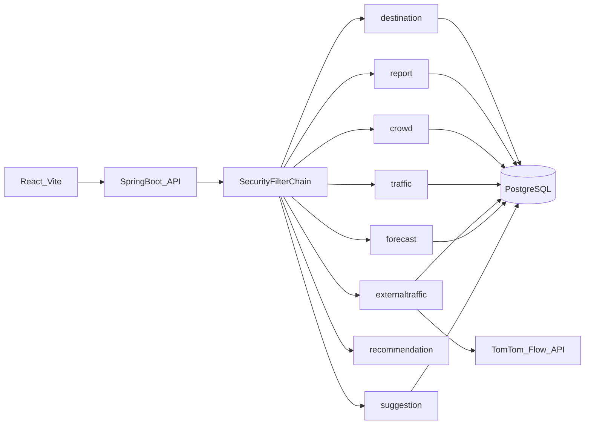

# Architecture

## Style

**Modular monolith** (Spring Boot) + separate **React/Vite** SPA. One PostgreSQL database. Crowd, traffic, and forecasts are **computed on read** — no precomputed score tables in v1.

## Packages (`com.pdcm`)

| Package | Responsibility |
|---|---|
| `user` | Register, login, profile, roles |
| `destination` | CRUD (admin write), search, nearby, map bounds |
| `report` | Visit report submit; GPS verification; coord purge; advisory-lock rate limits |
| `moderation` | ADMIN report verify/reject/flag + audit events |
| `crowd` | Deterministic crowd aggregation (no HTTP) |
| `traffic` | Destination **community** traffic aggregation (no HTTP) |
| `externaltraffic` | TomTom Flow pilot; on-demand 3h in-memory cache; zoom fallback; daily/monthly budgets; provider health metadata |
| `forecast` | Calendar signals + conditional numeric estimate |
| `recommendation` | Nearby alternatives |
| `dashboard` | Popularity vs verified crowd; forecast quality; provider status display; catalogue coverage |
| `security` | JWT issue/validate, filter chain, password hashing |
| `common` | Errors, validation, pagination, UTC/Kolkata helpers |

## Request lifecycle (authenticated)

1. Client sends `Authorization: Bearer <jwt>`.  
2. `SecurityFilterChain` validates JWT (Nimbus); sets authentication with role.  
3. Controller binds/validates DTO (`@Valid`).  
4. Service applies business rules (possibly `@Transactional`).  
5. Repository reads/writes PostgreSQL.  
6. Service maps to response DTO (never exposes password hash or reporter email publicly).  
7. Global exception handler maps failures to consistent error JSON.

Controllers contain **no** scoring logic.

## Frontend surfaces

Login/register · destination list/detail · **map/list discover** (Leaflet + React-Leaflet, OSM raster tiles) · report form with optional GPS proximity consent · dashboard (popular places vs verified crowd honesty, separate community traffic, forecast quality, provider availability strip, freshness/confidence/source, calendar signals, recent reports with trust labels, quieter-known alternatives) · ADMIN moderation queue. Crowd/community traffic use **LOCATION_VERIFIED** reports only after the Phase 3 cutover; Phase 4 adds 24h coord purge and ADMIN verify/reject/flag with audit.

Map discover loads destinations for the current viewport via `GET /api/destinations/map`. Crowd and traffic are fetched **only for the selected destination** through the existing detail endpoints — never one request per marker. Missing reports remain `UNKNOWN`.

## Map tiles

Configurable HTTPS OSM standard raster URL (`VITE_OSM_TILE_URL`, default community `tile.openstreetmap.org`). Visible attribution links to https://www.openstreetmap.org/copyright. No paid map/geocoding service, no tile proxy, no bulk prefetch. Catalogue coordinates come from Wikidata CC0 + legacy seeds — not from OSM imports. See [DATA_PROVENANCE.md](DATA_PROVENANCE.md).

## Out of MVP architecture

Redis, Kafka, WebSockets, separate AI/Python service, microservices, PostGIS.

## Hybrid travel intelligence phasing

Architecture proposal: [docs/proposals/PHASE0_HYBRID_TRAVEL_INTELLIGENCE.md](proposals/PHASE0_HYBRID_TRAVEL_INTELLIGENCE.md).

Phases 1–6 are implemented (map UX, TomTom Flow pilot, GPS verification, trust/moderation + coord purge, destination suggestions approval workflow, dashboard information quality). CULTURAL/ADVENTURE category expansion and pilot evaluation remain later phases.

### Destination suggestions (Phase 5)

Package `com.pdcm.suggestion` is separate from visit reports. Users submit proposals; only ADMIN approve/reject. Approval inserts into existing `destinations` with provenance — never auto-publishes without review, never fabricates crowd/traffic reports.
