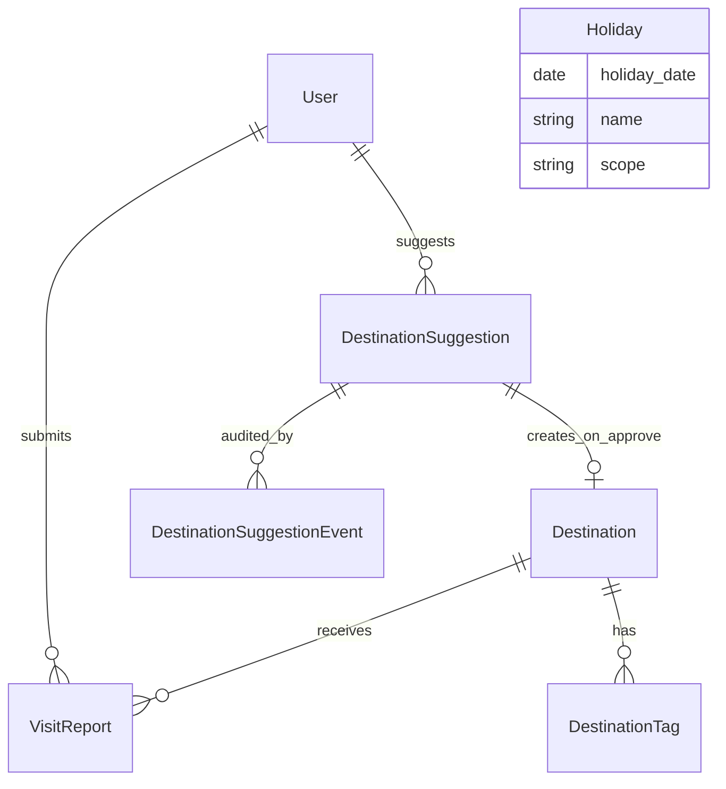

# Database Design

## ER (logical)

`Holiday` is **standalone reference data** (no FK relationships).  
`DestinationTag` is **not** a first-class domain entity — it is the JPA `@ElementCollection` join table for tags.  
`DestinationSuggestion` stays out of the public catalogue until ADMIN approve creates a `destinations` row.

## Tables

### `users`

| Column | Notes |
|---|---|
| id | PK |
| email | unique, not null |
| display_name | not null |
| password_hash | BCrypt; never in API responses |
| role | `USER` \| `ADMIN` |
| created_at | `timestamptz` UTC |

### `destinations`

| Column | Notes |
|---|---|
| id | PK |
| name | not null |
| slug | unique |
| description | text |
| region | e.g. state/region label |
| city | optional locality label (Flyway **V6**) |
| category | enum/string |
| latitude, longitude | double |
| crowd_sensitivity | optional; omit when unknown |
| source_reference | provenance label (e.g. `Wikidata Q…` or `LEGACY_SEED`) |
| source_url | optional source URL |
| source_license | e.g. `CC0` or `UNKNOWN` for legacy |
| active | boolean |
| created_at, updated_at | UTC |

Indexes (V6): `idx_destinations_city`, `idx_destinations_lat_lon`. Seed catalogue is ~100 active India places; **no** visit reports are seeded. Details: [DATA_PROVENANCE.md](DATA_PROVENANCE.md).

### `provider_health` / `provider_request_stats` (V7)

Metadata only for external providers (TomTom pilot). **No TomTom traffic payloads** are stored. Observation cache remains **in-memory** (default 3h TTL) — Phase 0 research treats long-term TomTom storage as a licence blocker until exact developer Terms are reviewed. Daily `provider_request_stats` rows also feed monthly usage totals (sum in app code; no monthly table).

### `destination_tags`

| Column | Notes |
|---|---|
| destination_id | FK → destinations |
| tag | varchar |

Owned by Destination via `@ElementCollection`. No separate tag id.

### `visit_reports`

| Column | Notes |
|---|---|
| id | PK |
| destination_id | FK |
| user_id | FK |
| crowd_intensity | 1–5 |
| traffic_condition | `LIGHT` \| `MODERATE` \| `HEAVY` \| `UNKNOWN` |
| wait_minutes | optional |
| note | optional, length-capped |
| observed_at | UTC instant |
| created_at | UTC instant (used for cooldown/daily cap) |
| verification_status | `LEGACY_UNVERIFIED` \| `PENDING` \| `LOCATION_VERIFIED` \| `FLAGGED` \| `REJECTED` (V8) |
| verification_reason | machine code (e.g. `NO_CONSENT`, `WITHIN_GEOFENCE`); public-safe |
| client_latitude / client_longitude | **private** GPS sample; never on public APIs |
| client_accuracy_m | private GPS accuracy |
| distance_to_destination_m | server Haversine metres; public APIs omit; admin summary may show |
| location_consent_at | when consent was recorded |
| location_purged_at | set when raw client coords/accuracy are purged (Phase 4; default retention 24h) |

### `report_moderation_events` (V9)

| Column | Notes |
|---|---|
| id | PK |
| report_id | FK → visit_reports |
| actor_user_id | FK → users (ADMIN who acted) |
| from_status / to_status | verification status transition |
| note | optional moderator note (≤500) |
| created_at | UTC instant |

Audit trail for ADMIN verify / reject / flag. Does not store coordinates.

### `destination_suggestions` (V10)

| Column | Notes |
|---|---|
| id | PK |
| name | proposed destination name |
| normalized_name | lower/trimmed/punctuation-stripped for duplicate hints |
| city | nearest town / locality |
| region | state / UT label (same spirit as `destinations.region`) |
| category | existing `DestinationCategory` values only |
| description | reason / description text |
| latitude / longitude | optional pair; required before approve; soft India bbox in app |
| reference_url | optional http(s) URL |
| submitter_user_id | FK → users |
| status | `SUBMITTED` \| `APPROVED` \| `REJECTED` |
| admin_note | optional moderation note |
| created_destination_id | FK → destinations when approved (unique when set) |
| created_at / updated_at | UTC |

### `destination_suggestion_events` (V10)

| Column | Notes |
|---|---|
| id | PK |
| suggestion_id | FK → destination_suggestions |
| actor_user_id | FK → users (submitter on submit; ADMIN on approve/reject) |
| action | `SUBMITTED` \| `APPROVED` \| `REJECTED` |
| from_status / to_status | suggestion status transition |
| note | optional |
| created_at | UTC |

Approval never inserts `visit_reports`.

### `holidays`

| Column | Notes |
|---|---|
| id | PK |
| holiday_date | `DATE` (India calendar date) |
| name | text |
| scope | `NATIONAL` |

Seeded in Flyway **V5** with fixed-date national holidays for 2026 and 2027 only: Republic Day, Independence Day, Gandhi Jayanti, Christmas. Lunar and state holidays are not invented. Not user-generated.

**Long weekend:** Friday through Monday when that Friday or that Monday is a row in `holidays`. A Wednesday holiday sets `isNationalHoliday` and does not set `isLongWeekend`. Weekend means Saturday or Sunday. The numeric forecast does not multiply these flags.

## Timestamps

- Persist: **UTC** (`timestamptz` / `Instant`).  
- India calendar day, holidays, daily caps: **`Asia/Kolkata`**.  
- API: ISO-8601 UTC with `Z`.

## Crowd aggregation (current)

**Input:** latest report **per user** for the destination with `observed_at` in the last **6 hours** and `verification_status = LOCATION_VERIFIED` only (GPS cutover). `LEGACY_UNVERIFIED`, `PENDING`, `FLAGGED`, and `REJECTED` are preserved but excluded. Older reports excluded from current status (kept for history). Empty set → `UNKNOWN`, score `null`, confidence `NONE`, `contributingReports = 0`.

`LOCATION_VERIFIED` means server-side proximity at submit time — **not** proof the report content is genuine.

**Effective age** for weighting: `age = max(0, now − observed_at)`.

If `observed_at` is slightly in the future within the allowed **60-second** submit skew, treat age as **0** (full weight 1.0). Do not use a negative age.

**Weights** (using effective age):

| Age | Weight |
|---|---|
| `0 ≤ age < 1h` | 1.0 |
| `1h ≤ age < 3h` | 0.6 |
| `3h ≤ age < 6h` | 0.3 |
| `age ≥ 6h` | excluded |

**Score** = Σ(intensity × weight) / Σ(weight), rounded to **1 decimal**.

**Status** (after rounding; contiguous 0.1 steps):

| Score | Status |
|---|---|
| 1.0 – 1.5 | QUIET |
| 1.6 – 2.5 | MODERATE |
| 2.6 – 3.5 | BUSY |
| 3.6 – 4.5 | CROWDED |
| 4.6 – 5.0 | OVERCROWDED |

**Agreement:** `spread = max(intensity) − min(intensity)`. Agreeing: `spread ≤ 1`. Disagreeing: `spread ≥ 2`.

**Confidence:**

| Reports | Agreeing | Disagreeing |
|---|---|---|
| 0 | NONE | — |
| 1 | LOW | — |
| 2–4 | MEDIUM | LOW |
| ≥ 5 | HIGH | MEDIUM |

Traffic fields do not affect crowd score.

## Traffic aggregation (separate)

Same 6‑hour latest-per-user set. Drop `UNKNOWN` traffic. If none remain → destination traffic `UNKNOWN`, confidence `NONE`.

Map LIGHT=1, MODERATE=2, HEAVY=3. Status = **mode**; ties → more severe (HEAVY > MODERATE > LIGHT).

Confidence by count: 1 → LOW; 2–4 → MEDIUM; ≥5 → HIGH. No age weighting beyond the 6h window.

## Report rate limits

| Rule | Value |
|---|---|
| Cooldown | 1 report / user / destination / 30 minutes (`created_at`) |
| Daily cap | **10** reports / user / India calendar day (`Asia/Kolkata`), all destinations |

**Concurrency:** one `pg_advisory_xact_lock` keyed **only by `user_id`** per submit transaction. Serializes all concurrent submits from that user (any destination). Check daily count + cooldown inside the lock, then insert. Never take a second advisory lock in the same transaction (deadlock avoidance). See [TECHNICAL_DECISIONS.md](TECHNICAL_DECISIONS.md).

## Forecast history threshold & calculation

Calendar signals are always returned. Numeric crowd estimate rules:

1. **Window:** `observed_at` within the past **90 days** relative to query `asOf` (UTC instant).
2. **Same weekday:** India local day-of-week of `observed_at` (`Asia/Kolkata`) equals the target date’s day-of-week.
3. **Usable:** `crowd_intensity` in 1–5 and `verification_status = LOCATION_VERIFIED` (same cutover as live aggregation).
4. **Dedup (anti-inflation):** keep only the **latest** report per `(user_id, India calendar date of observed_at)`. Multiple same-day reports from one user count as **one** observation. The same user on different Saturdays may contribute multiple samples (one per day).
5. **`sampleSize`:** count after dedup. If `sampleSize < 5` → `forecastStatus = INSUFFICIENT_DATA`, numeric fields `null`, confidence `NONE`.
6. **`estimatedIntensity`:** arithmetic mean of deduped intensities, rounded to **1 decimal**. No age weighting for historical forecast samples.
7. **`estimatedStatus`:** apply the same score→status bands as current crowd (1.0–1.5 QUIET … 4.6–5.0 OVERCROWDED).
8. **Confidence:** `LOW` if 5–9 samples; `MEDIUM` if ≥ 10. Label always `ESTIMATE` when numeric fields are present.

Do not seed or fabricate history. The public submit API also cannot insert observations older than 24 hours, so a live `ESTIMATE` waits for real reports. API shapes: [API_DOCUMENTATION.md](API_DOCUMENTATION.md).

## `observedAt` validation (submit)

| Rule | Value |
|---|---|
| Future | Reject if `observedAt` > server `Instant.now()` (allow ≤ **60 seconds** ahead for clock skew) |
| Max backdate | Reject if `observedAt` < `now − 24 hours` |
| Cooldown / daily cap | Use **`created_at` only** (server time), never `observedAt` |

Invalid `observedAt` → `400 VALIDATION_ERROR`. Rate limits unchanged.

## Users & visit reports (Day 2 — Flyway V4)

### `users`
email (unique), display_name, password_hash (BCrypt), role (`USER`|`ADMIN`), created_at UTC.

### `visit_reports`
destination_id FK, user_id FK, crowd_intensity 1–5, traffic_condition enum, optional wait_minutes / note, observed_at, created_at. Indexes on `(user_id, created_at)` and `(user_id, destination_id, created_at)` for caps.

Rate limits use `pg_advisory_xact_lock(hashtext('pdcm:report:' || user_id))` inside the submit transaction.

## GPS verification (Phase 3 — Flyway V8)

Adds verification columns to `visit_reports`. Existing rows are backfilled to `LEGACY_UNVERIFIED` / `PRE_CUTOVER` (not deleted, not promoted). New submits without consent become `PENDING`. Consent + usable GPS inside the configured geofence (default 500 m) with accuracy ≤ 150 m → `LOCATION_VERIFIED`. Soft spoofing/glitch samples (null island / outside rough India box) → `FLAGGED`. Precise client coordinates are stored privately and **never** returned on public DTOs.

### V9 — moderation audit + purge support

Creates `report_moderation_events`, review/purge indexes, and extends `verification_reason` with `ADMIN_VERIFIED` / `ADMIN_REJECTED` / `ADMIN_FLAGGED`. Raw client lat/lon/accuracy are auto-purged after configurable retention (**default 24 hours** / `PT24H`); status, reason, distance, and consent metadata remain.

## Out of schema (v1)

No crowd_scores, traffic_snapshots, refresh_tokens, or Redis-backed counters.
