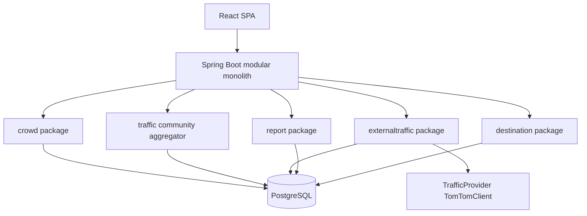

# Phase 0 – Hybrid Travel Intelligence Architecture (Proposal)

**Status:** Approved (2026-11-14) with recorded decisions.  
**Implementation:** Sequence started with map loading fix only; TomTom and later phases await per-phase approval.  
**Scope of this doc:** Architecture reference. Production work proceeds phase-by-phase outside this file.

This document is the Phase 0 deliverable for evolving PDCM into a hybrid travel intelligence platform: external road traffic where coverage is reliable, community crowd (and separate community traffic) reports, and a moderated destination catalogue — without pretending missing data is quiet.

---

## 1. Current-state audit (repository)

### Stack and docs (as implemented)

| Area | Location |
|---|---|
| README / stack | `README.md` |
| Architecture | `docs/ARCHITECTURE.md` |
| Database / algorithms | `docs/DATABASE_DESIGN.md` |
| API contracts | `docs/API_DOCUMENTATION.md` |
| Roadmap | `docs/DEVELOPMENT_ROADMAP.md` |
| Decisions | `docs/TECHNICAL_DECISIONS.md` |
| Destination provenance | `docs/DATA_PROVENANCE.md` |
| Requirements | `docs/PROJECT_REQUIREMENTS.md` |

### Backend packages (`com.pdcm`)

| Package | Key types | Role today |
|---|---|---|
| `destination` | `Destination`, `DestinationService`, `DestinationController`, `MapBoundsRequest` | List/search/map bounds/nearby; 100 active India places |
| `report` | `VisitReport`, `VisitReportService`, `RecentObservations`, `ReportWindow`, `CreateVisitReportRequest` | Submit + 6h freshness window; daily 10 / 30m cooldown; `observedAt` rules |
| `crowd` | `CrowdStatusService`, `CrowdAggregator`, `CrowdSummary` | On-read aggregation; source `"USER_REPORTS"`; empty → `UNKNOWN` |
| `traffic` | `TrafficStatusService`, `TrafficAggregator`, `TrafficSummary` | Mode of non-`UNKNOWN` traffic from same reports; empty → `UNKNOWN` |
| `forecast` | `ForecastService`, `ForecastCalculator`, `IndiaCalendar`, `Holiday` | Calendar always; numeric estimate only if ≥5 same-weekday samples / 90d |
| `recommendation` | `RecommendationService` | Nearby alternatives; never treats missing crowd as quiet |
| `dashboard` | `DashboardService`, `DashboardController` | Popular / quieter-known / recent reports / calendar highlight |
| `user` / `security` | `AuthService`, `SecurityConfig`, JWT Nimbus, `AdminBootstrap` | Register/login/`/me`; role `USER`/`ADMIN` |
| `common` | `GeoUtils`, `PageResponse`, `GlobalExceptionHandler`, `JacksonConfig` | Haversine; float→int coercion disabled for intensity |

There is **no** external traffic client, provider interface, GPS geofence validation, report verification status, or destination-suggestion workflow today.

### Flyway migrations (do not edit applied ones)

| Version | File | Purpose |
|---|---|---|
| V1 | `V1__create_destinations.sql` | `destinations` + tags |
| V2 | `V2__seed_destinations.sql` | 20 legacy seeds |
| V3 | indexes | Reinforced indexes |
| V4 | `V4__create_users_and_visit_reports.sql` | `users`, `visit_reports` |
| V5 | `V5__create_holidays.sql` | National holidays 2026–2027 |
| V6 | `V6__destinations_city_provenance_and_catalogue.sql` | `city` + provenance; +80 Wikidata rows → **100** total |

### Aggregation honesty (preserve)

- Freshness: 6 hours (`ReportWindow.FRESHNESS`) — `backend/.../report/ReportWindow.java`
- Crowd/traffic computed on read from `RecentObservations` — not precomputed score tables
- Forecast: `INSUFFICIENT_DATA` without enough history — no fabricated samples
- Intensity: DB check 1–5; Bean Validation; Jackson `ACCEPT_FLOAT_AS_INT` disabled; frontend `/^[1-5]$/` parser

### Map / frontend (relevant to §7)

| Piece | Path |
|---|---|
| Map discover page | `frontend/src/pages/MapDiscoverPage.tsx` |
| Leaflet map | `frontend/src/components/DestinationMap.tsx` |
| Bounds helpers | `frontend/src/mapBounds.ts` |
| List messaging | `frontend/src/mapDiscover.ts` |
| API client | `frontend/src/api.ts` (`destinationsMap`, `crowd`, `traffic`) |
| Map endpoint | `DestinationController` `GET /api/destinations/map` |

**Root cause of selection → loading flicker:** selecting a marker runs `SelectedFocus` → `map.panTo(...)` → Leaflet `moveend` → `BoundsWatcher` → `setBounds` → list effect sets `loading=true` while previous rows remain → `discoverListMessage` shows “Loading…”. Selection can also clear if the refreshed bounds response omits the selected id.

### Tests to keep green

Backend: destination/map/crowd/traffic/forecast/auth/intensity suites under `backend/src/test/...`.  
Frontend: `crowdIntensity.test.ts`, `mapBounds.test.ts`, `mapDiscover.test.ts`.

### Pilot destinations (already in catalogue)

| Slug | Seed |
|---|---|
| `amber-fort` | V2 |
| `gateway-of-india` | V2 |
| `hawa-mahal` | V2 |
| `india-gate` | V2 |
| `taj-mahal` | V2 |

---

## 2. External provider comparison

### Research constraints followed

- Official TomTom / HERE documentation consulted; no accounts created, no billing enabled, no live billable API calls from this phase.
- No Google Maps / popular-times scraping.
- Coverage claims treated as **marketing/list coverage until pilot measurement** on approach roads.

### TomTom (primary candidate)

| Topic | Finding | Official references |
|---|---|---|
| India coverage | India appears on TomTom traffic coverage lists (consumer/help coverage includes India). **Not a substitute for attraction-approach QA.** | [TomTom Traffic coverage](https://help.tomtom.com/hc/en-us/articles/35890351157266-TomTom-Traffic-coverage); [Traffic APIs product](https://www.tomtom.com/products/traffic-apis/) |
| Flow Segment Data | Point query for road fragment nearest to coordinates. SDK/docs fields include `currentSpeed`, `freeFlowSpeed`, travel times, `confidence`, road class/coordinates. Fits “one fetch per selected destination / scheduled pilot destination,” not per map marker. | [Traffic Flow service overview](https://developer.tomtom.com/traffic-api/documentation/traffic-flow/traffic-flow-service); Flow Segment response fields in TomTom Traffic SDK refs (e.g. `FlowSegmentDataResponse`) |
| Incidents | Incident Details v5: bbox or ids; categories (accident, jam, road works, etc.); present/future validity filters. Useful as **road context**, never as crowd. | [Incident Details](https://developer.tomtom.com/traffic-api/documentation/traffic-incidents/incident-details) |
| Free quota (store, current) | Store page shows free monthly allowances, e.g. **Flow Segment Data free 20K/month**; **Incident Details free 2.5K/month**; flow/incident **tiles** free **200K/month**. Prefer Segment Data for PDCM (structured speeds, fewer tiles). Quotas/pricing change — re-check before Phase 1. | [TomTom Maps API store / pricing](https://developer.tomtom.com/store/maps-api) |
| Rate limits | HTTP **429** documented on traffic endpoints; self-serve QPS historically modest — design client-side throttle + backoff. | Incident Details / Flow docs response codes |
| Display | Results may be shown in applications subject to TomTom API terms; attribution/copyright notices as required by license. | TomTom developer / product terms |
| Caching / storage | Industry and partner comparisons repeatedly state TomTom **restricts long-term storage** and building derivative databases; short-lived cache per response headers is the safe default. **Must be verified against the exact developer Terms accepted when an API key is created** before persisting rows. | Developer portal Terms (to be accepted at signup); compare notes such as caching clauses discussed publicly — treat as **approval gate**, not settled law |
| Refresh cadence | Product materials cite ~30s update of underlying traffic; PDCM should refresh **far less often** (e.g. 5–15 min per pilot destination) to respect quota and honesty about staleness. | [TomTom Traffic APIs](https://www.tomtom.com/products/traffic-apis/) |
| Orbis vs classic | Docs recommend Orbis Maps for new integrations where available; classic Traffic Flow Segment remains listed on the store. Phase 1 should pick the **current** Segment/Orbis equivalent documented at implementation time. | Store + Traffic Flow docs |

**Pilot request budget (illustrative):** 5 destinations × 1 Flow Segment call every 10 minutes ≈ 720 calls/day ≈ 21.6K/month — near/at the advertised 20K free Flow Segment allowance. Prefer **15 min** (~14.4K/month) or on-demand-only for selected detail pages during pilot.

### HERE Traffic (alternative)

| Topic | Finding | Reference |
|---|---|---|
| India | Explicit markets: India Central / North / South — Flow + Incidents | [HERE Traffic coverage](https://docs.here.com/traffic-api/docs/traffic-here-traffic-api-v7-coverage-information) |
| Pricing | Real-time Traffic: **0–5,000 transactions/month free**, then paid tiers; registration notes often require a card even if free tier unused | [HERE pricing](https://www.here.com/get-started/pricing) |
| Fit | Strong coverage transparency; card requirement conflicts with “no billing activation” until you approve. Keep as fallback if TomTom approach-road quality fails pilot. |

### Recommendation

1. **Design provider-neutral** `TrafficProvider` now.  
2. **Pilot TomTom Flow Segment Data** (+ optional Incident Details for approach bbox) for the five destinations after you approve key creation.  
3. Keep **HERE** as documented alternative; do not dual-wire both in Phase 1.  
4. **Never** map road flow → crowd status.

### Pilot validation protocol (before expanding to 100)

1. Manually call Flow Segment (and a small Incident bbox) for each pilot lat/lon at peak and off-peak (after you authorize a free-tier key).  
2. Score: response present? road class sensible? relative speed vs free-flow meaningful? confidence non-trivial? approach road vs tourist parking lot?  
3. Compare qualitatively with open observation (not Google scrape).  
4. Pass criteria (proposed): ≥4/5 destinations return usable flow with confidence above a chosen floor; document failures as `UNAVAILABLE` not quiet.  
5. Only then schedule catalogue-wide enablement with per-destination feature flags.

---

## 3. Recommended hybrid architecture



### Principles

1. **Separate channels:** community crowd, community traffic, external road traffic — never silently merged into one status.  
2. **Fail open for core product:** provider outage → external channel `UNAVAILABLE`/`UNKNOWN`; destinations, auth, and visit reports keep working.  
3. **Fetch on schedule or on detail selection — never per map marker.** Map markers stay catalogue-only.  
4. **In-process cache + DB snapshot with TTL** (no Redis/Kafka). Honor provider cache headers; purge expired rows.  
5. **Attribution** on every external payload (`provider`, `attributionText`, `fetchedAt`, `expiresAt`).  
6. **Calendar / holidays** remain context only (`forecast` / dashboard), never an “observation.”

### Suggested new package: `com.pdcm.externaltraffic`

| Component | Responsibility |
|---|---|
| `TrafficProvider` | Interface: `fetchFlow(lat,lon)`, optional `fetchIncidents(bbox)` |
| `TomTomTrafficClient` | HTTP client, timeouts, retries with jitter, 429 handling |
| `ExternalTrafficNormalizer` | Map provider payload → PDCM `ExternalTrafficObservation` |
| `ExternalTrafficRefreshJob` | `@Scheduled` for flagged pilot destinations |
| `ExternalTrafficCache` | Caffeine or simple concurrent map + DB write-through |
| `ProviderHealthService` | Success/failure counts, last error, circuit-open flag |
| `ExternalTrafficService` | Read API used by controllers |

### Contradictory observations (UX)

Show **two panels**, not a blended score:

- **Approach roads (provider):** LIGHT/MODERATE/HEAVY or UNKNOWN + freshness + attribution.  
- **On-site traffic (community):** existing aggregator + report count + confidence.  
- If both present and disagree: explicit copy — “Road data and traveler reports disagree; compare freshness and decide.”  
- Never average them into one badge.

---

## 4. Proposed database design (no migrations yet)

### A. External traffic (ephemeral — subject to Terms approval)

`external_traffic_observations`

| Column | Notes |
|---|---|
| id | PK |
| destination_id | FK destinations |
| provider | e.g. `TOMTOM` |
| observation_type | `FLOW` \| `INCIDENT_SUMMARY` |
| status | mapped `LIGHT`/`MODERATE`/`HEAVY`/`UNKNOWN`/`UNAVAILABLE` |
| current_speed_kph, freeflow_speed_kph, provider_confidence | nullable numerics |
| sample_lat, sample_lon | query point used |
| raw_ref | opaque provider segment id / hash — **not** full raw dump if Terms forbid |
| fetched_at, expires_at | UTC |
| attribution | text |

`provider_health`

| Column | Notes |
|---|---|
| provider | PK |
| status | `UP`/`DEGRADED`/`DOWN` |
| last_success_at, last_failure_at | |
| last_error_code | |
| consecutive_failures | |

**Retention:** delete/overwrite when `expires_at` passes (minutes–hours, not months). Do **not** build a TomTom history warehouse unless Terms explicitly allow.

### B. Report verification (community)

Extend `visit_reports` (new Flyway later) or side table `visit_report_verifications`:

| Column | Notes |
|---|---|
| report_id | FK |
| verification_status | see §6 |
| client_lat, client_lon | retained briefly |
| accuracy_m | GPS accuracy |
| distance_m_to_destination | server-computed |
| geofence_result | `INSIDE`/`OUTSIDE`/`UNKNOWN` |
| consent_location_at | when user consented |
| location_purged_at | after retention window |
| moderator_note, moderated_by, moderated_at | admin |

Preserve existing intensity/traffic/`observedAt`/cooldown/daily caps.

### C. Destination suggestions

`destination_suggestions` — separate from `destinations` until approved (see §7).

---

## 5. Proposed API contracts

Reuse `ApiError`, JWT auth, and DTO style from `docs/API_DOCUMENTATION.md`.

### External traffic

| Method | Path | Auth | Notes |
|---|---|---|---|
| GET | `/api/destinations/{id}/traffic/external` | public | Latest non-expired provider observation or `UNAVAILABLE` |
| GET | `/api/destinations/{id}/traffic` | public | **Unchanged** community aggregator |
| GET | `/api/providers/traffic/status` | public | Aggregate provider health (no secrets) |

Example external response shape:

```json
{
  "destinationId": 1,
  "channel": "EXTERNAL_ROAD",
  "provider": "TOMTOM",
  "status": "MODERATE",
  "currentSpeedKph": 18,
  "freeFlowSpeedKph": 40,
  "providerConfidence": 0.82,
  "fetchedAt": "2026-11-14T12:00:00Z",
  "expiresAt": "2026-11-14T12:15:00Z",
  "freshness": "FRESH",
  "attribution": "Traffic data © TomTom",
  "message": null
}
```

Community traffic response keeps `source: "USER_REPORTS"`. Add optional `freshness: FRESH|STALE|NONE` later without breaking clients.

### Reports + verification

| Method | Path | Auth | Notes |
|---|---|---|---|
| POST | `/api/destinations/{id}/reports` | USER | Extend body with optional `clientLocation` + `locationConsent`; preserve intensity 1–5 |
| GET | `/api/admin/reports?status=` | ADMIN | Moderation queue |
| PATCH | `/api/admin/reports/{id}/verification` | ADMIN | Flag / reject / note |

### Destination suggestions

| Method | Path | Auth | Notes |
|---|---|---|---|
| POST | `/api/destination-suggestions` | USER | Create suggestion |
| GET | `/api/me/destination-suggestions` | USER | Own submissions |
| GET | `/api/admin/destination-suggestions` | ADMIN | Queue |
| POST | `/api/admin/destination-suggestions/{id}/approve` | ADMIN | Creates `destinations` row + provenance |
| POST | `/api/admin/destination-suggestions/{id}/reject` | ADMIN | Reason required |
| POST | `/api/admin/destination-suggestions/{id}/request-info` | ADMIN | Back to user |

Approved destinations still expose crowd/traffic **UNKNOWN** until real reports exist.

---

## 6. GPS and report-trust design

### Status model (refined)

Proposed statuses are **almost** sufficient; refine as:

| Status | Meaning |
|---|---|
| `PENDING` | Accepted under existing rate limits; location not checked or consent denied |
| `LOCATION_VERIFIED` | Server distance within geofence/corridor **at submit time** — **not** proof of truth |
| `FLAGGED` | Suspicious pattern / impossible travel / low accuracy / duplicate |
| `REJECTED` | Moderator or hard rule excluded from aggregation |
| `INCLUDED` (optional rename) | Explicit “eligible for aggregation” if you want LOCATION_VERIFIED ≠ automatic include |

**Decision (implemented Phase 3):** Aggregation whitelist = **`LOCATION_VERIFIED` only** after cutover. Historical rows stay `LEGACY_UNVERIFIED` (preserved, not promoted). `PENDING`/`FLAGGED`/`REJECTED` are excluded from verified community aggregation.

**Decision (implemented Phase 4):** ADMIN moderation with audit; coord retention **default 24h** then purge; explicit verify required to promote `FLAGGED`/`PENDING` (never `LEGACY`); public trust labels without PII. Weighted trust scoring beyond status labels remains deferred.

### Validation stages

1. Browser: request GPS only with **explicit consent** checkbox; send lat/lon/accuracy.  
2. Server: Haversine to destination (`GeoUtils`); configurable radius (e.g. crowd 300–500 m; traffic corridor longer polyline buffer — Phase 2 v1 can use larger circle).  
3. Accuracy gate: if `accuracy_m` > threshold → `PENDING` or `FLAGGED`, never auto-trusted.  
4. Keep existing `observedAt` window and caps.  
5. Impossible travel (Phase 3): compare last LOCATION_VERIFIED report coords/time vs claimed speed.  
6. Abuse: burst accounts, identical notes, device fingerprints deferred; start with rate limits + flags.

### Privacy

- Consent recorded; precise coords retained **short TTL** (**Phase 4 decision: default 24 hours**, configurable) then purged; keep distance / status / reason only.  
- Photos/videos: **Phase later** — object storage, malware scan, moderation, EXIF strip, retention, optional blur; never mandatory.

---

## 7. Destination suggestion & moderation

### Entity `DestinationSuggestion`

Fields: name, proposed slug (optional), description, region, city, category, lat/lon, source_reference, source_url, evidence_urls (optional), submitter_user_id, status (`SUBMITTED`/`NEEDS_INFO`/`APPROVED`/`REJECTED`), admin notes, duplicate_of_destination_id, created/updated.

### Categories

Map user-facing labels to existing enum where possible:

| Suggestion UI | Existing `DestinationCategory` |
|---|---|
| Historical | `HISTORICAL` |
| Religious | `TEMPLE` |
| Nature | `NATURE` |
| Beach | `BEACH` |
| Wildlife | `WILDLIFE` |
| Hill station | `HILL_STATION` |
| Cultural / Adventure | **Needs approval** — either map to `CITY`/`NATURE` temporarily or extend enum in a dedicated migration |

### Workflow

1. User submits → validate coords in India bbox, required fields.  
2. Server finds nearby (Haversine) + similar name → warn / link duplicates; still allow submit with `possibleDuplicate`.  
3. Admin reviews; AI optional later for classification **assist only** — never auto-approve.  
4. Approve → insert `destinations` with provenance (`USER_SUGGESTION` + reviewer) + contributor attribution; active for map/reporting.  
5. Crowd/traffic remain UNKNOWN until genuine observations.

---

## 8. Dashboard and map improvements

### Map/list minimal fix (Phase 5 or early opportunistic)

In `MapDiscoverPage` / `DestinationMap`:

1. Split `initialLoading` vs `isRefreshing`; only show full-list loading on first load.  
2. Do not clear `destinations` on refresh failure — keep last good set + toast/banner.  
3. Ignore bounds updates within epsilon of last queried bounds; debounce already 250ms — add equality check after clamp.  
4. `SelectedFocus`: pan without treating as user browse, **or** suppress bounds-driven fetch while `programmaticPanRef` is true.  
5. Keep `selectedId` even if temporarily outside result set; still show detail from last known destination object.  
6. Crowd/traffic: fetch only when `selectedId` changes (already); add AbortController / ignore stale responses.

### Dashboard information quality

Extend snapshots (additive fields) to show:

- Crowd: source, freshness, confidence, contributingReports  
- Traffic community + external channels side by side  
- Provider availability strip  
- Conflict callout when channels disagree  
- UNKNOWN/stale copy (“Unknown is not quiet”)  
- CTA: “Report what you see” when UNKNOWN  
- Catalogue coverage: active destination count / regions

---

## 9. Security and privacy considerations

- API keys only in env (`PDCM_TOMTOM_API_KEY`); never in frontend.  
- Outbound HTTP timeouts; no SSRF (fixed TomTom hosts).  
- JWT/admin gates for moderation and suggestions.  
- Location consent + retention/purge job.  
- Do not log full GPS in application logs.  
- Attribution strings from config.  
- Continue intensity validation and report advisory locks.  
- Legal review of TomTom/HERE Terms before any persistent storage beyond short TTL cache.

---

## 10. Prioritized implementation roadmap

Recommended order **adjusted slightly**: fix map refresh UX early (cheap, improves trust) can ship as **Phase 1a** or at start of Phase 5; keep provider pilot before GPS (external traffic value is independent of GPS).

### Phase 0 — Architecture & provider validation (this document)

- Deliverables: this proposal; no code.  
- Acceptance: your written approval of provider, storage policy, and phase order.

### Phase 1 — External traffic pilot

| Item | Detail |
|---|---|
| Files | New `externaltraffic/*`; `TrafficController` or new controller; `application.yml` props; optional dashboard fields; frontend detail/map selection panel |
| Migrations | `external_traffic_observations`, `provider_health`; destination flag `external_traffic_enabled` |
| APIs | `GET .../traffic/external`, `GET /providers/traffic/status` |
| Frontend | Detail + map selection: dual traffic panels; attribution |
| Tests | Client stub/mocks; refresh job; failure isolation; no merge with community traffic |
| Acceptance | 5 pilot destinations; UNKNOWN/UNAVAILABLE on failure; no per-marker calls; community APIs unchanged |
| Risks | Terms on storage; free quota; India approach-road quality |

### Phase 2 — GPS community verification

| Item | Detail |
|---|---|
| Files | `VisitReport` (+ verification); `VisitReportService`; report form UI; consent copy |
| Migrations | verification columns / side table |
| APIs | extended POST reports; admin list/patch |
| Tests | geofence unit tests; spoofing cannot force “truth”; caps preserved |
| Acceptance | Without consent, report still allowed as `PENDING`; LOCATION_VERIFIED ≠ authoritative claim in UI |
| Risks | Spoofed GPS; poor accuracy indoors |

### Phase 3 — Trust scoring & moderation

| Item | Detail |
|---|---|
| Files | trust service; admin UI; optional impossible-travel |
| Acceptance | FLAGGED/REJECTED excluded from aggregation; audit trail |
| Risks | False positives harming honest users |

### Phase 4 — Destination suggestions

| Item | Detail |
|---|---|
| Files | `suggestion` package; admin + user UI |
| Migrations | `destination_suggestions` |
| Acceptance | No unreviewed publish; approved → UNKNOWN crowd/traffic |
| Risks | Duplicate spam; category enum expansion |

### Phase 5 — Dashboard / map information quality

| Item | Detail |
|---|---|
| Files | `MapDiscoverPage`, `DestinationMap`, dashboard DTOs/UI |
| Acceptance | No loading flicker on select; stale-safe refresh; dual-source clarity |
| Deps | Benefits from Phases 1–2 data |

### Phase 6 — Pilot evaluation & wider rollout

| Item | Detail |
|---|---|
| Work | Coverage scorecard; enable flags beyond 5; quota budgeting; optional HERE trial |
| Acceptance | Written go/no-go for remaining destinations |

---

## 11. Decisions requiring your explicit approval

1. **Proceed with TomTom** as Phase 1 provider (vs HERE-first, vs delay external traffic).  
2. **Create a TomTom developer account / API key** (free tier) when you are ready — not done in Phase 0.  
3. **Storage policy:** short-TTL snapshot in Postgres vs memory-only cache until counsel/Terms review.  
4. **Refresh policy:** scheduled (10–15 min) vs on-demand on destination detail only for pilot.  
5. **Aggregation rule for GPS:** include `PENDING` + `LOCATION_VERIFIED`, or LOCATION_VERIFIED-only after a cutover.  
6. **New categories** Cultural/Adventure — extend enum vs map onto existing values.  
7. **Whether to ship map loading fix before Phase 1** (recommended).  
8. **Photo/video evidence** — defer (recommended) or schedule a dedicated phase.  
9. **Any paid overage / Pay As You Grow** — remains **off** until you approve billing.

---

## 12. Out of scope (reaffirmed)

- Production code or Flyway migrations in Phase 0  
- Fabricated reports/observations/forecasts  
- Redis, Kafka, microservices, PostGIS  
- Google scraping / popular times  
- Treating road traffic as attraction crowd  
- Presenting calendar context as live observations

---

*End of Phase 0 proposal. Waiting for approval before any implementation.*
